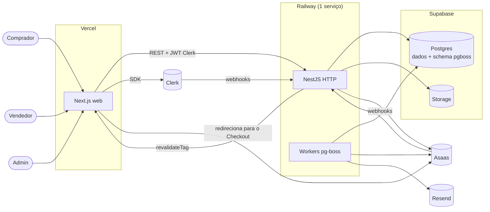
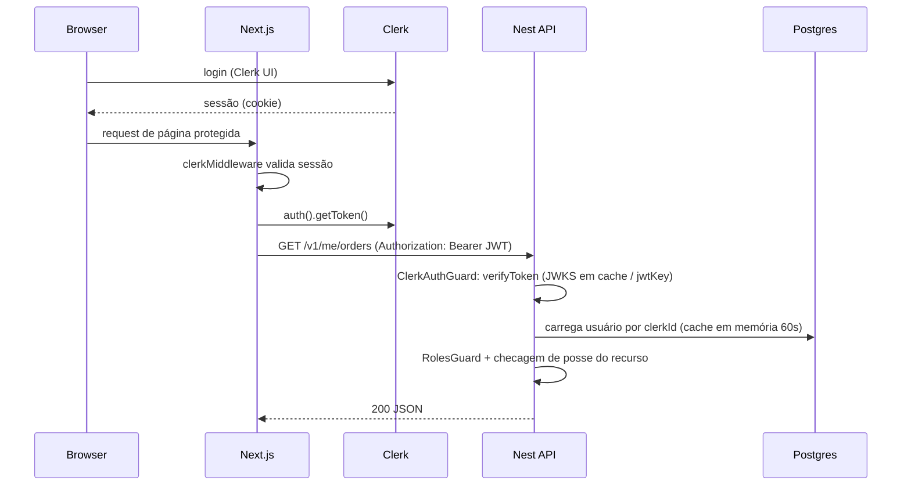
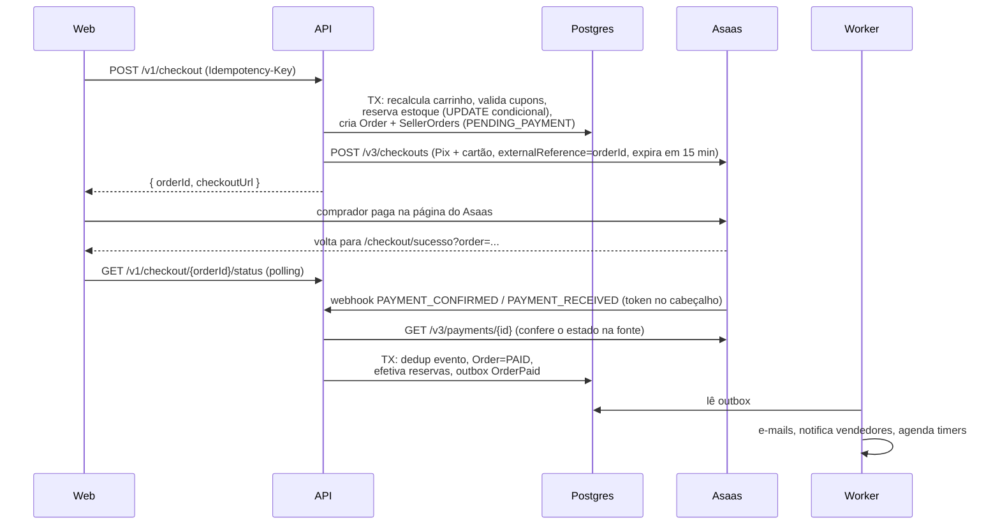
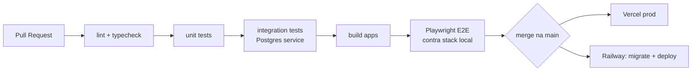

# Arquitetura — Vitrine

## 1. Stack

| Camada | Tecnologia | Motivo |
|---|---|---|
| Monorepo | Turborepo + pnpm workspaces | Builds incrementais, tipos compartilhados ([ADR-0001](adr/0001-monorepo-turborepo.md)) |
| Frontend | Next.js (App Router, RSC), React, TypeScript | SSR/ISR para SEO e performance |
| UI | Tailwind CSS + shadcn/ui + Radix | Acessível por padrão, customizável |
| Estado cliente | TanStack Query; Zustand só para UI local | Cache de servidor separado de estado de UI |
| Formulários | React Hook Form + Zod | Validação compartilhada |
| Backend | NestJS, TypeScript | Módulos, DI, guards — monólito modular ([ADR-0002](adr/0002-nest-monolito-modular.md)) |
| Auth | Clerk (`@clerk/nextjs`, `@clerk/backend`) | ([ADR-0003](adr/0003-clerk-autenticacao.md)) |
| Banco | Supabase Postgres + Prisma | ([ADR-0004](adr/0004-supabase-postgres-prisma.md)) |
| Arquivos | Supabase Storage (upload via URL assinada) | Mesmo provedor do banco, CDN incluída |
| Pagamentos | Asaas: Checkout hospedado (Pix e cartão) e repasse por Pix para a chave da loja | ([ADR-0011](adr/0011-asaas-subcontas-e-transferencias.md) e [ADR-0012](adr/0012-repasse-por-pix-sem-subcontas.md); substituem a ADR-0005) |
| Filas/jobs | pg-boss (no próprio Postgres) | Escolhido no lugar de Redis/BullMQ **por custo**: evita um serviço pago ([ADR-0009](adr/0009-filas-pg-boss.md)) |
| Cache / rate limit | Em memória (LRU no processo) | Instância única na demo; Redis só se escalar ([ADR-0009](adr/0009-filas-pg-boss.md)) |
| Busca | Postgres FTS (`portuguese` + `unaccent`) + `pg_trgm` | ([ADR-0007](adr/0007-busca-postgres-fts.md)) |
| E-mail | Resend + React Email | Templates em React, tipados |
| Contrato | OpenAPI gerado pelo Nest → `openapi-typescript` + `openapi-fetch` | ([ADR-0008](adr/0008-contrato-openapi.md)) |
| Observabilidade | pino, Sentry, OpenTelemetry → Grafana Cloud (free) | |
| Testes | Vitest, Testcontainers, Supertest, Playwright, k6 | |
| CI/CD | GitHub Actions; Vercel (web); Railway (api + worker num serviço) | ([ADR-0010](adr/0010-api-e-worker-mesmo-processo.md)) |

## 2. Visão de contexto



- **web** nunca acessa o banco diretamente. Toda regra de negócio vive na API.
- **HTTP** e **workers** são o mesmo código Nest com dois *entrypoints* (`main.ts` e `worker.ts`). Em produção rodam **no mesmo processo** (`RUN_WORKER=true`); para escalar, viram serviços separados sem mudar código ([ADR-0010](adr/0010-api-e-worker-mesmo-processo.md)).
- **Sem Redis, por custo**: filas no Postgres (pg-boss), cache e rate limit em memória. Num cenário de produção real com volume, a recomendação seria voltar para Redis/BullMQ.

## 3. Estrutura do monorepo

```
vitrine/
├─ apps/
│  ├─ web/                    # Next.js
│  │  ├─ app/
│  │  │  ├─ (store)/          # loja pública: home, busca, PDP, loja, carrinho, checkout
│  │  │  ├─ (account)/        # minha conta: pedidos, endereços, wishlist
│  │  │  ├─ seller/           # painel do vendedor
│  │  │  ├─ admin/            # painel admin
│  │  │  └─ api/revalidate/   # endpoint de revalidação chamado pela API
│  │  ├─ components/
│  │  ├─ lib/api/             # cliente tipado (openapi-fetch)
│  │  └─ middleware.ts        # clerkMiddleware + proteção de rotas
│  └─ api/                    # NestJS
│     ├─ src/
│     │  ├─ main.ts           # HTTP (+ workers se RUN_WORKER=true)
│     │  ├─ worker.ts         # só workers pg-boss (para deploy separado no futuro)
│     │  ├─ shared/           # Money, erros, paginação, Prisma, pg-boss, cache, outbox
│     │  └─ modules/
│     │     ├─ identity/  sellers/  catalog/  search/  cart/
│     │     ├─ checkout/  orders/   payments/ payouts/ returns/
│     │     ├─ promotions/ reviews/ notifications/ media/ admin/
│     └─ prisma/              # schema, migrations, seed
├─ packages/
│  ├─ api-client/             # tipos gerados do OpenAPI
│  ├─ emails/                 # templates React Email
│  ├─ config/                 # eslint, tsconfig, prettier
│  └─ shared/                 # utilitários puros (formatação de moeda, slug)
├─ docs/
├─ infra/                     # docker-compose, k6, scripts
└─ .github/workflows/
```

## 4. Backend: camadas por módulo

Cada módulo segue arquitetura em camadas (Clean Architecture leve), com dependências apontando para dentro:

```
modules/orders/
├─ domain/          # entidades, value objects, regras puras, eventos de domínio — sem Nest/Prisma
├─ application/     # casos de uso (ex.: ShipSellerOrderUseCase), portas (interfaces de repositório/gateway)
├─ infra/           # PrismaOrderRepository, adapters externos
└─ http/            # controllers, DTOs (Zod), guards específicos
```

Regras:
- **Módulos se comunicam por** (a) serviços públicos exportados explicitamente ou (b) eventos de domínio via outbox. Nunca importam `infra/` de outro módulo.
- **Gateways externos atrás de portas**: `PaymentGateway` (Asaas), `StorageGateway` (Supabase), `ShippingCalculator`, `Mailer`. Facilita testes e troca futura.
- **Transações**: casos de uso que mudam mais de um agregado usam `UnitOfWork` (Prisma `$transaction` interativa) e gravam eventos na tabela `outbox_events` na mesma transação.
- **Erros**: exceções de domínio tipadas → mapeadas para `application/problem+json` (RFC 9457) por um filtro global.

## 5. Autenticação e autorização



- **Fonte de verdade de papéis: banco da plataforma.** Os papéis são espelhados em `publicMetadata` no Clerk apenas para a UI decidir o que exibir.
- Webhooks do Clerk (`user.created`, `user.updated`, `user.deleted`) sincronizam a tabela `users` (verificação Svix).
- Autorização em três níveis: autenticado → papel (`@Roles('seller')`) → posse (`sellerOrder.sellerId === currentSeller.id`).

## 6. Fluxo crítico: checkout e pagamento



Garantias:
- **Idempotência do checkout**: `Idempotency-Key` (UUID do cliente) gravada com hash do payload e resposta; repetição devolve a mesma resposta.
- **Idempotência de webhook**: tabela `asaas_events` com o `id` do evento único; evento repetido é ignorado. Como o Asaas não assina os avisos, o token do cabeçalho é conferido e o estado é sempre reconsultado na API do Asaas.
- **Anti-overselling**: `UPDATE product_variants SET reserved = reserved + :q WHERE id = :id AND stock - reserved >= :q` — se 0 linhas afetadas, item indisponível e a transação aborta.
- **Fonte de verdade do pagamento é o webhook**, nunca o redirect do cliente.

Fluxos de repasse, reembolso e chargeback: ver [specs/05](specs/05-pagamentos-e-repasses.md) e [specs/07](specs/07-devolucoes-e-reembolsos.md).

## 7. Processamento assíncrono

Filas com **pg-boss** no Postgres (schema `pgboss`), conectado pelo session pooler do Supabase com pool de 3 conexões. Jobs atrasados usam `startAfter`; rotinas diárias usam `schedule` (cron).

| Fila / job | Gatilho | Ação |
|---|---|---|
| `outbox-relay` | a cada 2 s | publica eventos pendentes da outbox em filas pg-boss |
| `notifications` | `OrderPaid`, `SellerOrderShipped`, ... | envia e-mails |
| `reservation-expiry` | job atrasado 15 min por pedido | libera reservas e expira o Checkout se ainda não pago |
| `auto-confirm-delivery` | diário | entrega automática 15 dias após despacho (RN-9) |
| `payout-release` | diário + job atrasado | transfere por Pix, para a chave da loja, os sub-pedidos elegíveis (RN-11), descontando dívidas |
| `ship-deadline` | diário | marca sub-pedidos atrasados (RN-8) |
| `search-reindex` | `ProductUpdated` | atualiza vetor de busca e revalida cache do Next |

Todos os consumidores são idempotentes (chave por evento/entidade), com retry exponencial e fila de *dead letter*. Concorrência baixa por fila para não competir com as requisições HTTP no mesmo processo.

## 8. Cache e renderização

| Página | Estratégia |
|---|---|
| Home, categoria (PLP), PDP, loja | RSC com `fetch` cacheado + `revalidateTag` (`product:{id}`, `store:{id}`, `category:{id}`); a API chama `/api/revalidate` ao mudar dados |
| Estoque/preço na PDP | componente cliente busca disponibilidade fresca (não cacheada) |
| Busca | dinâmica, sem cache de página; cache em memória de 30 s por query normalizada |
| Carrinho, checkout, contas, painéis | dinâmicas, autenticadas |

Árvore de categorias e configurações da plataforma em cache em memória (LRU, porta `CacheStore`) com invalidação por evento. Válido para instância única; com várias instâncias, trocar o adapter por Redis.

## 9. Segurança

- Clerk JWT verificado em toda rota não pública; CSRF não se aplica (Bearer token, sem cookie na API).
- `helmet`, CORS restrito ao domínio do web, `@nestjs/throttler` com storage em memória (global 100 req/min/IP; checkout 10/min/usuário).
- Validação Zod em todas as entradas; IDs como UUID/cuid; nenhuma query SQL concatenada.
- Uploads: URL assinada com expiração de 60 s, MIME e tamanho validados (≤ 5 MB, jpeg/png/webp).
- Supabase: acesso só pela API com `service_role` mantido no servidor; RLS habilitado negando acesso a `anon` como defesa em profundidade.
- Segredos via variáveis de ambiente; `.env.example` documentado; `gitleaks` no CI.
- Logs sem PII (e-mail mascarado, nenhum endereço completo).

## 10. Ambientes e deploy

| Ambiente | Web | API/Worker | Banco | Asaas |
|---|---|---|---|---|
| Local | `next dev` | `nest start --watch` (`RUN_WORKER=true`) | Postgres no Docker Compose | sandbox + túnel (`cloudflared`) para os webhooks |
| Preview (por PR) | Vercel Preview | — (usa a API de produção) | — | sandbox |
| Produção (demo) | Vercel | Railway (1 serviço, `RUN_WORKER=true`) | Supabase | sandbox |

Migrações: `prisma migrate deploy` como passo de *release* na Railway antes do novo container receber tráfego. O pg-boss cria/migra o próprio schema ao iniciar.

### Custos estimados (demo)

| Serviço | Plano | Custo/mês |
|---|---|---|
| Vercel | Hobby | US$ 0 |
| Clerk | Free | US$ 0 |
| Supabase (Postgres + Storage) | Free | US$ 0 |
| Railway (API + workers) | Hobby (US$ 5 inclui US$ 5 de uso) | US$ 5 |
| Resend, Sentry, Grafana Cloud | Free | US$ 0 |
| Asaas | Sandbox | R$ 0 |
| Domínio (opcional) | .com.br | ~R$ 40/ano |

Cuidados:
- **Limite de gasto** configurado no Railway para nunca passar do crédito.
- `NODE_OPTIONS=--max-old-space-size=256` para limitar memória.
- **Supabase gratuito pausa após inatividade**: GitHub Action agendada chama `/health/ready` diariamente.
- Valores de referência; revisar as páginas de preço antes de contratar.

## 11. CI/CD



- Turborepo remote cache para acelerar.
- Checagem de drift: `prisma migrate diff` falha se schema e migrações divergirem.
- Checagem de contrato: OpenAPI gerado no CI deve bater com `packages/api-client` commitado.
- Conventional Commits + Husky + lint-staged.

## 12. Estratégia de testes

| Nível | Ferramenta | Foco | Meta |
|---|---|---|---|
| Unitário | Vitest | domínio: cálculo de comissão, split de cupom, máquinas de estado, Money | ≥ 80% domínio/aplicação |
| Integração | Vitest + Testcontainers (Postgres) + Supertest | repositórios, casos de uso com transação, webhooks com payload assinado | fluxos críticos |
| Contrato | geração OpenAPI + typecheck do web | quebras de contrato | 100% endpoints |
| E2E | Playwright | jornadas: comprar multi-loja, despachar, devolver, admin aprovar loja | 6–8 jornadas |
| Carga/concorrência | k6 | 200 checkouts simultâneos do último item → 1 sucesso | 0 overselling |
| Acessibilidade | axe (Playwright) + Lighthouse CI | regressões a11y/perf | metas do PRD |

Asaas em testes: unit/integração usam um `FakePaymentGateway` e webhooks simulados com o token de teste; E2E usa o sandbox do Asaas (cartões de teste e simulação de recebimento pela API do sandbox).

## 13. Observabilidade

- **Logs**: pino JSON com `requestId`, `userId`, `orderId`; correlação propagada para jobs.
- **Erros**: Sentry em web e api, com release e source maps.
- **Traces/métricas**: OpenTelemetry (HTTP, Prisma, jobs pg-boss) → Grafana Cloud. Métricas de negócio: pedidos pagos, falhas de pagamento, repasses, profundidade de filas, dead letter.
- **Health**: `/health/live` (processo) e `/health/ready` (Postgres e pg-boss iniciado).
