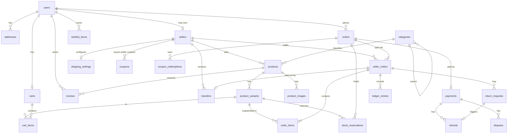
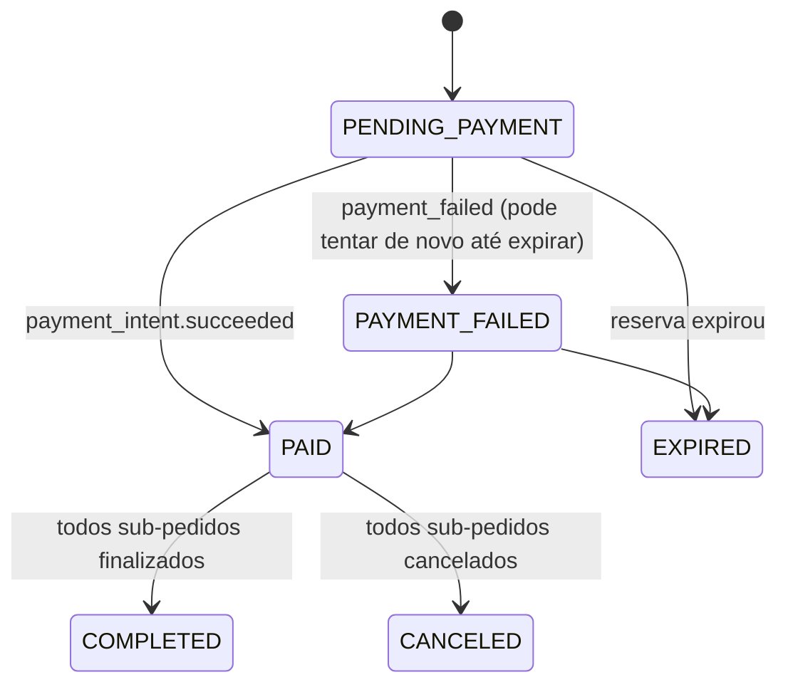
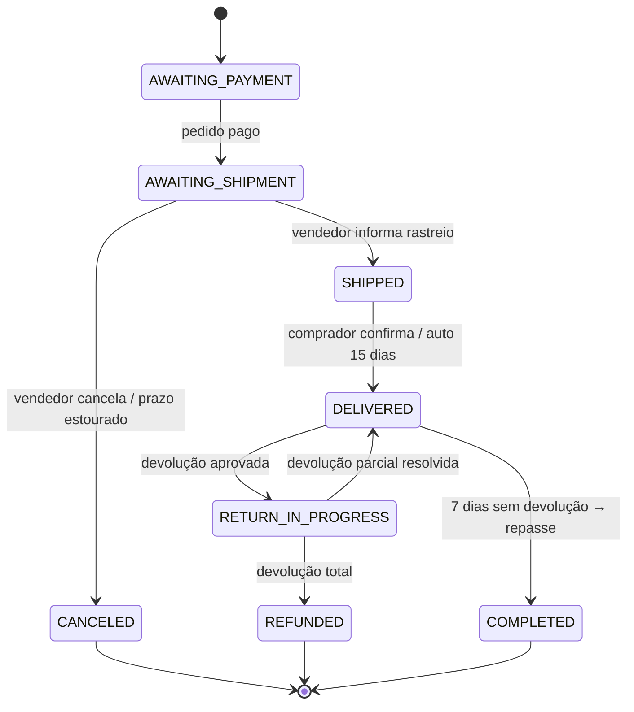

# Modelo de dados — Vitrine

Postgres (Supabase), schema gerenciado por Prisma. Convenções:
- PK `id` UUID v7 (ordenável no tempo).
- `created_at`, `updated_at` em todas as tabelas (UTC).
- Dinheiro em `*_cents INTEGER` (BRL). Nunca float.
- Exclusão lógica (`archived_at`/`deleted_at`) onde há histórico financeiro.

## 1. Diagrama entidade-relacionamento

## 2. Tabelas

### Identidade
**users** — `id`, `clerk_id` (único), `email` (único), `name`, `phone`, `roles text[]` (`customer`,`seller`,`admin`), `deleted_at`.

**addresses** — `id`, `user_id`, `label`, `recipient`, `zip_code`, `street`, `number`, `complement`, `district`, `city`, `state` (UF), `is_default`.

### Vendedores
**sellers** — `id`, `user_id` (único), `store_name`, `slug` (único), `bio`, `logo_url`, `banner_url`, `document` (CPF/CNPJ, criptografado em repouso), `status` (`PENDING`,`APPROVED`,`REJECTED`,`SUSPENDED`), `stripe_account_id` (único), `stripe_charges_enabled`, `stripe_payouts_enabled`, `commission_bps` (nulo = padrão; 1200 = 12%), `rating_avg`, `rating_count`, `approved_at`.

**shipping_settings** — `seller_id` (PK), `origin_zip`, `rates jsonb` (por região: `{ "SE": 1990, "S": 2490, ... }`), `free_shipping_threshold_cents`, `handling_days`.

### Catálogo
**categories** — `id`, `parent_id`, `name`, `slug` (único na árvore inteira, inclusive entre arquivadas), `position`, `size_type` (`CLOTHING`, `SHOES`, `ONE_SIZE`: define a grade de tamanhos das variantes), `size_chart jsonb` (`{ columns, rows }`), `archived_at` (arquivada junto com as descendentes; nunca apagada).

**products** — `id`, `seller_id`, `category_id`, `title`, `slug` (único por loja), `description`, `condition` (`NEW`,`USED`), `status` (`DRAFT`,`ACTIVE`,`ARCHIVED`,`SUSPENDED`), `search_vector tsvector` (gerado), `min_price_cents` (denormalizado p/ ordenação), `sold_count`, `rating_avg`, `rating_count`, `published_at`.

**product_variants** — `id`, `product_id`, `sku` (único por loja), `size`, `color`, `color_hex`, `price_cents`, `compare_at_cents`, `stock`, `reserved`, `weight_grams`, `archived_at`.
Restrição: `CHECK (stock >= 0 AND reserved >= 0 AND reserved <= stock)`; `UNIQUE(product_id, size, color)`.

**product_images** — `id`, `product_id`, `url`, `alt`, `position`, `color` (nulo = todas as cores).

### Carrinho
**carts** — `id`, `user_id` (nulo para visitante, único quando presente), `anonymous_token` (único), `expires_at`.
**cart_items** — `id`, `cart_id`, `variant_id`, `quantity`; `UNIQUE(cart_id, variant_id)`.
**cart_coupons** — `cart_id`, `coupon_id`.

### Pedidos
**orders** — `id`, `number` (sequencial legível, ex. `VT-000123`), `user_id`, `status`, `shipping_address jsonb` (snapshot), `items_total_cents`, `shipping_total_cents`, `discount_total_cents`, `grand_total_cents`, `idempotency_key` (único), `reservation_expires_at`, `paid_at`, `canceled_at`.

**seller_orders** — `id`, `order_id`, `seller_id`, `status`, `items_subtotal_cents`, `shipping_cents`, `seller_discount_cents`, `platform_discount_cents`, `commission_bps`, `commission_cents`, `payout_amount_cents`, `tracking_code`, `carrier`, `shipped_at`, `delivered_at`, `ship_deadline_at`, `payout_eligible_at`.

**order_items** — `id`, `seller_order_id`, `variant_id`, `product_title`, `variant_label`, `image_url`, `unit_price_cents`, `quantity`, `total_cents`, `refunded_quantity`.

**stock_reservations** — `id`, `order_id`, `variant_id`, `quantity`, `status` (`ACTIVE`,`COMMITTED`,`RELEASED`), `expires_at`.

### Pagamentos e financeiro
**payments** — `id`, `order_id` (único), `stripe_payment_intent_id` (único), `stripe_charge_id`, `status` (`REQUIRES_PAYMENT`,`PROCESSING`,`SUCCEEDED`,`FAILED`,`CANCELED`), `amount_cents`, `amount_refunded_cents`, `method` (`card`,`pix`).

**transfers** — `id`, `seller_order_id` (único), `seller_id`, `stripe_transfer_id` (único), `amount_cents`, `reversed_cents`, `status` (`PENDING`,`PAID`,`PARTIALLY_REVERSED`,`REVERSED`,`FAILED`).

**refunds** — `id`, `payment_id`, `seller_order_id`, `return_request_id`, `stripe_refund_id`, `amount_cents`, `reason`, `status`.

**disputes** — `id`, `payment_id`, `stripe_dispute_id`, `amount_cents`, `reason`, `status`, `evidence_due_by`.

**ledger_entries** — livro-razão append-only por sub-pedido: `id`, `seller_order_id`, `type` (`SALE`,`COMMISSION`,`SELLER_DISCOUNT`,`REFUND`,`TRANSFER`,`TRANSFER_REVERSAL`,`DISPUTE`), `amount_cents` (com sinal), `reference_id`. Saldo do vendedor = soma das entradas. Permite auditoria e reconciliação com o Stripe.

### Promoções e engajamento
**coupons** — `id`, `code` (único, case-insensitive), `seller_id` (nulo = plataforma), `type` (`PERCENT`,`FIXED`), `value` (bps ou centavos), `min_subtotal_cents`, `max_discount_cents`, `starts_at`, `ends_at`, `usage_limit`, `per_user_limit`, `used_count`, `active`.
**coupon_redemptions** — `coupon_id`, `order_id`, `user_id`, `discount_cents`.
**reviews** — `id`, `product_id`, `order_item_id` (único), `user_id`, `rating` (1–5), `title`, `body`, `photos text[]`, `status` (`PUBLISHED`,`HIDDEN`).
**wishlist_items** — `user_id`, `product_id` (PK composta).
**return_requests** — `id`, `seller_order_id`, `items jsonb` (`[{orderItemId, quantity}]`), `reason`, `description`, `photos`, `status`, `return_tracking_code`, `resolved_at`.

### Infraestrutura
**outbox_events** — `id`, `aggregate_type`, `aggregate_id`, `type`, `payload jsonb`, `created_at`, `published_at`, `attempts`.
**stripe_events** — `id` (= `event.id` do Stripe), `type`, `received_at`, `processed_at`.
**idempotency_keys** — `key`, `user_id`, `request_hash`, `response jsonb`, `status_code`, `expires_at`.
**audit_logs** — `id`, `actor_user_id`, `action`, `entity_type`, `entity_id`, `before jsonb`, `after jsonb`, `ip`, `created_at`.
**platform_settings** — `key`, `value jsonb` (comissão padrão, prazos).

## 3. Máquinas de estado

### Order

### SellerOrder

### ReturnRequest
`REQUESTED → APPROVED → ITEM_SHIPPED → RECEIVED → REFUNDED`; ou `REQUESTED → REJECTED` (comprador pode escalar ao admin → `ESCALATED`).

Transições são implementadas no domínio (`sellerOrder.ship(tracking)`), que rejeita transições inválidas com `InvalidStateTransitionError`. Atualizações usam *optimistic locking* (`WHERE id = ? AND status = ?`).

## 4. Índices principais

| Tabela | Índice | Uso |
|---|---|---|
| products | GIN(`search_vector`) | busca textual |
| products | GIN(`title gin_trgm_ops`) | tolerância a erro de digitação |
| products | (`status`, `category_id`, `min_price_cents`) | PLP filtrada/ordenada |
| products | (`seller_id`, `status`) | página da loja, painel |
| product_variants | (`product_id`), (`size`), (`color`) | facetas |
| seller_orders | (`seller_id`, `status`, `created_at DESC`) | painel do vendedor |
| seller_orders | (`status`, `payout_eligible_at`) | job de repasse |
| orders | (`user_id`, `created_at DESC`) | meus pedidos |
| stock_reservations | (`status`, `expires_at`) | expiração |
| outbox_events | (`published_at`) WHERE `published_at IS NULL` | relay |

## 5. Cálculos (exemplo)

Pedido com duas lojas, cupom de plataforma de 10% (máx R$ 30) e cupom da loja A de R$ 20:

| | Loja A | Loja B |
|---|---|---|
| Subtotal itens | 20000 | 10000 |
| Cupom da loja | −2000 | 0 |
| Cupom plataforma: 10% de 28000 = 2800, rateado proporcionalmente à base | −1800 | −1000 |
| Frete | 1990 | 2490 |
| **Comprador paga** | 18190 | 11490 → total 29680 |
| Base de comissão (subtotal − cupom loja) | 18000 | 10000 |
| Comissão 12% | 2160 | 1200 |
| **Repasse** = base − comissão + frete | 17830 | 11290 |

Plataforma recebe 29680, repassa 29120, fica com 560 brutos (3360 de comissão − 2800 do cupom que ela custeou), dos quais paga a taxa Stripe. O cupom de plataforma incide sobre a soma das bases (após cupons de loja), sem frete. Arredondamento: comissão por `Math.round` (half-even) por sub-pedido; resto do rateio do cupom vai para a última loja.
