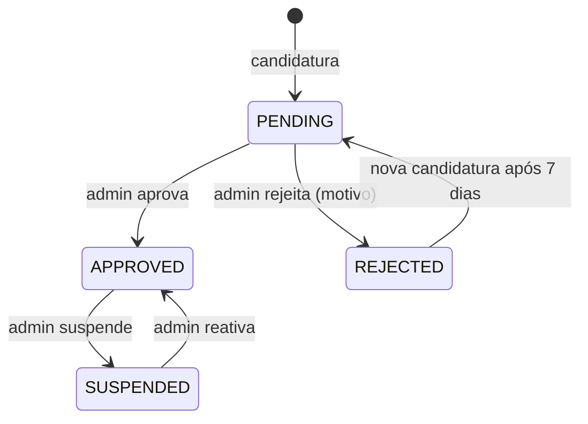

# Spec 02 — Vendedores e onboarding

**Requisitos:** RF-SELLER-1..6, RF-ADM-1 · RN-2, RN-3, RN-16 · **Módulo Nest:** `sellers`

## Objetivo
Permitir que um usuário vire vendedor de forma controlada: candidatura → chave Pix de recebimento conferida → aprovação → loja pública.

## Fluxo

O repasse vai para a **chave Pix** da loja ([ADR-0012](../adr/0012-repasse-por-pix-sem-subcontas.md)): não existe conta da loja no Asaas. A loja só **vende** quando `status = APPROVED` **e** tem uma chave Pix conferida (`pix_key_verified_at` preenchido).

## Histórias e critérios de aceite

### H1 — Candidatura
- Formulário: nome da loja, slug (sugerido, editável, único), bio, CPF/CNPJ (validação de dígitos), categoria principal, Instagram (opcional).
- Chave Pix de recebimento (tipo e chave), conferida na hora (H3).
- Cria `sellers` com `PENDING`; usuário ainda não recebe papel `seller`.
- Uma candidatura ativa por usuário.

### H2 — Aprovação pelo admin
- Ao aprovar: papel `seller` adicionado ao usuário e e-mail com as próximas etapas. O admin vê, na candidatura, o titular da chave Pix devolvido pelo Asaas (nome e documento mascarado) e o resultado da conferência.
- Sem chave Pix conferida, o admin não consegue aprovar (`422`).
- Ao rejeitar: motivo obrigatório, enviado por e-mail.
- Toda decisão grava `audit_logs`.

### H3 — Chave Pix de recebimento
- Painel mostra checklist: "Dados da loja ✓ · Conta de recebimento ⏳ · Frete ⏳ · Primeiro produto ⏳".
- `PUT /seller/pix-key { type, key }` (tipos: CPF, CNPJ, EMAIL, PHONE, EVP) consulta o titular no Asaas (`GET /v3/pix/addressKeys/external`).
- **Conferência automática:** os dígitos visíveis do documento mascarado (ex.: `***.202.745-**`) precisam bater com o CPF/CNPJ da loja; senão → `422 PIX_KEY_OWNER_MISMATCH` e nada é salvo. Chave inexistente → `422 PIX_KEY_NOT_FOUND`.
- Chave aceita: guardamos tipo, chave, nome do titular, documento mascarado e `pix_key_verified_at`. Trocar a chave refaz a conferência; a troca é auditada e avisada por e-mail.
- `GET /seller/pix-key` mostra a chave atual e o titular conferido.
- Repasse com chave que deixou de existir no Asaas: a transferência falha, o repasse fica retido e o vendedor é avisado para cadastrar outra chave.

### H4 — Configuração de frete
- CEP de origem, valor por região (N, NE, CO, SE, S), frete grátis acima de X (opcional), prazo de manuseio (1–5 dias).
- Obrigatória antes de publicar o primeiro produto.

### H5 — Página pública da loja
- `/loja/{slug}`: banner, logo, bio, nota média, nº de vendas, produtos com mesmos filtros da PLP.
- Loja suspensa → 404 e produtos ocultos.

### H6 — Dashboard
- Período selecionável (7/30/90 dias): receita líquida, nº de pedidos, ticket médio, taxa de devolução, top 5 produtos, gráfico diário de vendas.
- Alertas: sub-pedidos próximos do prazo de despacho, estoque baixo (≤ 2), devoluções pendentes.

## Regras
- Comissão: `seller.commission_bps ?? platform_settings.default_commission_bps` (1200). Valor é **congelado no sub-pedido** no momento da compra.
- Vendedor não pode adicionar ao carrinho produtos da própria loja (RN-16).
- Suspensão não cancela sub-pedidos em andamento; repasses ficam retidos até revisão do admin.

## Eventos
`SellerApplied`, `SellerApproved`, `SellerRejected`, `SellerSuspended`, `SellerPixKeyChanged`.
