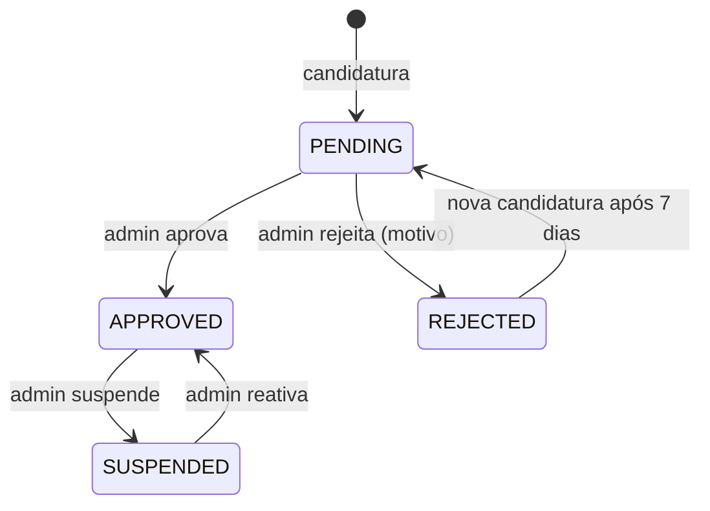

# Spec 02 — Vendedores e onboarding

**Requisitos:** RF-SELLER-1..6, RF-ADM-1 · RN-2, RN-3, RN-16 · **Módulo Nest:** `sellers`

## Objetivo
Permitir que um usuário vire vendedor de forma controlada: candidatura → aprovação → conta Stripe Connect habilitada → loja pública.

## Fluxo

Status Stripe é independente e vem de `account.updated`: a loja só **vende** quando `status = APPROVED` **e** `charges_enabled` **e** `payouts_enabled`.

## Histórias e critérios de aceite

### H1 — Candidatura
- Formulário: nome da loja, slug (sugerido, editável, único), bio, CPF/CNPJ (validação de dígitos), categoria principal, Instagram (opcional).
- Cria `sellers` com `PENDING`; usuário ainda não recebe papel `seller`.
- Uma candidatura ativa por usuário.

### H2 — Aprovação pelo admin
- Ao aprovar: papel `seller` adicionado ao usuário, conta Stripe Express criada (`type: express`, `country: BR`, `capabilities: card_payments, transfers`, `metadata.sellerId`), e-mail com link para concluir onboarding.
- Ao rejeitar: motivo obrigatório, enviado por e-mail.
- Toda decisão grava `audit_logs`.

### H3 — Onboarding Stripe
- Painel mostra checklist: "Dados da loja ✓ · Conta de recebimento ⏳ · Frete ⏳ · Primeiro produto ⏳".
- `POST /seller/stripe/onboarding-link` gera Account Link (`account_onboarding`) com `refresh_url` e `return_url` para o painel.
- Webhook `account.updated` (endpoint Connect) atualiza `stripe_charges_enabled`, `stripe_payouts_enabled` e `requirements.currently_due`; painel mostra pendências.
- Se o Stripe desabilitar a conta depois, produtos da loja somem da vitrine (filtro de consulta) e o vendedor é avisado por e-mail.

### H4 — Configuração de frete
- CEP de origem, valor por região (N, NE, CO, SE, S), frete grátis acima de X (opcional), prazo de manuseio (1–5 dias).
- Obrigatória antes de publicar o primeiro produto.

### H5 — Página pública da loja
- `/loja/{slug}`: banner, logo, bio, nota média, nº de vendas, produtos com mesmos filtros da PLP.
- Loja suspensa → 404 e produtos ocultos.

### H6 — Dashboard
- Período selecionável (7/30/90 dias): receita líquida, nº de pedidos, ticket médio, taxa de devolução, top 5 produtos, gráfico diário de vendas.
- Alertas: sub-pedidos próximos do prazo de despacho, estoque baixo (≤ 2), devoluções pendentes.

## Regras
- Comissão: `seller.commission_bps ?? platform_settings.default_commission_bps` (1200). Valor é **congelado no sub-pedido** no momento da compra.
- Vendedor não pode adicionar ao carrinho produtos da própria loja (RN-16).
- Suspensão não cancela sub-pedidos em andamento; repasses ficam retidos até revisão do admin.

## Eventos
`SellerApplied`, `SellerApproved`, `SellerRejected`, `SellerSuspended`, `SellerStripeStatusChanged`.
