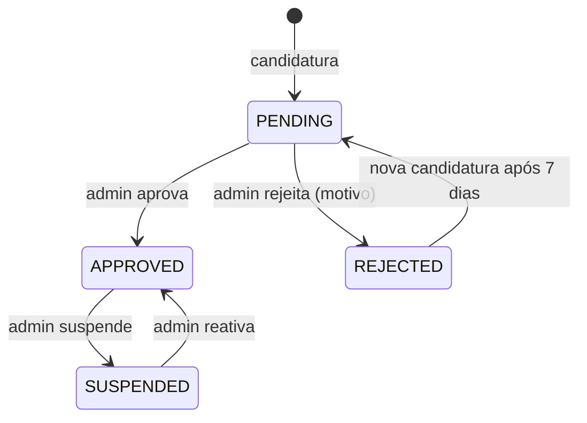

# Spec 02 — Vendedores e onboarding

**Requisitos:** RF-SELLER-1..6, RF-ADM-1 · RN-2, RN-3, RN-16 · **Módulo Nest:** `sellers`

## Objetivo
Permitir que um usuário vire vendedor de forma controlada: candidatura → aprovação → subconta Asaas aprovada → loja pública.

## Fluxo

A situação da subconta no Asaas é independente e vem dos eventos `ACCOUNT_STATUS_*` do webhook: a loja só **vende** quando `status = APPROVED` na Vitrine **e** a subconta está aprovada no Asaas (`asaas_account_status = APPROVED`).

## Histórias e critérios de aceite

### H1 — Candidatura
- Formulário: nome da loja, slug (sugerido, editável, único), bio, CPF/CNPJ (validação de dígitos), categoria principal, Instagram (opcional).
- Dados que o Asaas exige para criar a subconta: e-mail e celular de contato, endereço com CEP, faturamento mensal estimado e, conforme o documento, data de nascimento (CPF) ou tipo de empresa (CNPJ). Guardados com o documento (criptografado em repouso).
- Cria `sellers` com `PENDING`; usuário ainda não recebe papel `seller`.
- Uma candidatura ativa por usuário.

### H2 — Aprovação pelo admin
- Ao aprovar: papel `seller` adicionado ao usuário, **subconta Asaas criada** (`POST /v3/accounts` com os dados da candidatura); guardamos `asaas_account_id` e `asaas_wallet_id` (a chave de API da subconta não é guardada, ADR-0011); e-mail com as próximas etapas.
- A criação da subconta é idempotente (procura por e-mail/documento antes de criar) e, se o Asaas falhar, a aprovação fica registrada e a criação é refeita por job, sem aprovar duas vezes.
- Ao rejeitar: motivo obrigatório, enviado por e-mail.
- Toda decisão grava `audit_logs`.

### H3 — Subconta Asaas (onboarding)
- Painel mostra checklist: "Dados da loja ✓ · Conta de recebimento ⏳ · Frete ⏳ · Primeiro produto ⏳".
- `GET /seller/payment-account` mostra a situação da subconta e as pendências do cadastro no Asaas (`asaas_pending_items`).
- Se o Asaas pedir documentos, `POST /seller/payment-account/onboarding-link` leva a loja ao envio no Asaas (a forma exata, link de onboarding ou e-mail do próprio Asaas, é confirmada no spike).
- Webhook `/webhooks/asaas` com eventos `ACCOUNT_STATUS_*` atualiza `asaas_account_status` e as pendências; a aprovação final é `ACCOUNT_STATUS_GENERAL_APPROVAL_APPROVED`. No sandbox, a aprovação automática fica ligada.
- Se o Asaas reprovar ou desabilitar a subconta depois, produtos da loja somem da vitrine (filtro de consulta) e o vendedor é avisado por e-mail.

### H4 — Configuração de frete
- CEP de origem, valor por região (N, NE, CO, SE, S), frete grátis acima de X (opcional), prazo de manuseio (1–5 dias).
- Obrigatória antes de publicar o primeiro produto.

### H5 — Página pública da loja
- `/loja/{slug}`: banner, logo, bio, nota média, nº de vendas, produtos com mesmos filtros da PLP.
- Loja suspensa → 404 e produtos ocultos.

### H6 — Dashboard
- Período selecionável (7/30/90 dias): receita líquida, nº de pedidos, ticket médio, taxa de devolução, top 5 produtos, gráfico diário de vendas.
- Alertas: sub-pedidos próximos do prazo de despacho, estoque baixo (≤ 2), devoluções pendentes.

## Regras
- Comissão: `seller.commission_bps ?? platform_settings.default_commission_bps` (1200). Valor é **congelado no sub-pedido** no momento da compra.
- Vendedor não pode adicionar ao carrinho produtos da própria loja (RN-16).
- Suspensão não cancela sub-pedidos em andamento; repasses ficam retidos até revisão do admin.

## Eventos
`SellerApplied`, `SellerApproved`, `SellerRejected`, `SellerSuspended`, `SellerPaymentAccountStatusChanged`.
