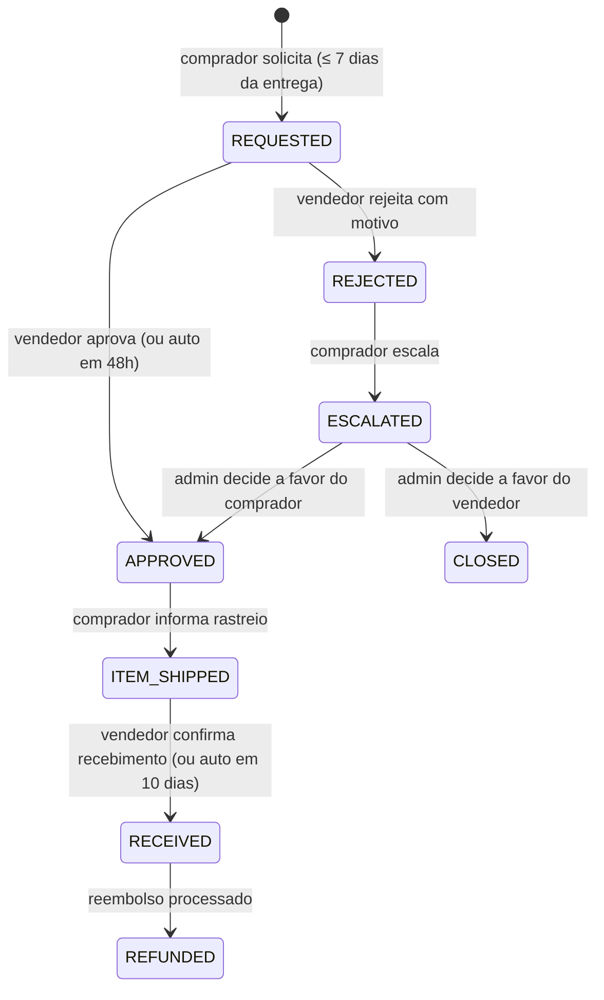

# Spec 07 — Devoluções, reembolsos e disputas

**Requisitos:** RF-RET-1..3, RF-ADM-3 · RN-10, RN-11, RN-15 · **Módulo Nest:** `returns` (+ `payments`, `payouts`)

## Objetivo
Garantir o direito de arrependimento e resolver problemas com reembolso parcial correto, ajustando o que a loja recebe — inclusive depois do repasse.

## Devolução



### Critérios de aceite
- Solicitar: escolher itens e quantidades do sub-pedido, motivo (não serviu, defeito, diferente do anúncio, arrependimento), descrição e até 3 fotos.
- Fora da janela de 7 dias → `422 RETURN_WINDOW_EXPIRED`.
- Abrir devolução **suspende o repasse** do sub-pedido (RN-11); se o repasse já ocorreu (caso raro: devolução escalada/admin), haverá estorno de transferência.
- Vendedor sem resposta em 48 h → aprovação automática.
- Frete de devolução: por conta do vendedor se motivo for defeito/diferente do anúncio; por conta do comprador nos demais (informativo no MVP, sem logística reversa integrada).

## Cálculo do reembolso
Para itens devolvidos de um sub-pedido:
```
valor_itens   = Σ unit_price × qtd_devolvida
desc_loja     = rateio proporcional do seller_discount aos itens
desc_plat     = rateio proporcional do platform_discount aos itens
reembolso     = valor_itens − desc_loja − desc_plat
              (+ frete integral se devolução total por defeito/diferente do anúncio)
comissão_dev  = round(commission_bps × (valor_itens − desc_loja))   ← devolvida à loja
```
- `stripe.refunds.create({ payment_intent, amount: reembolso, metadata: { sellerOrderId, returnRequestId } }, { idempotencyKey: 'refund:' + returnRequestId })`.
- Se já houve transfer: `stripe.transfers.createReversal(transferId, { amount: reembolso_parte_loja })` com `reembolso_parte_loja = valor_itens − desc_loja − comissão_dev (+ frete se aplicável)`. A plataforma absorve a parte do cupom de plataforma.
- `order_items.refunded_quantity` atualizado; estoque **não** volta automaticamente (vendedor decide ao receber: "repor no estoque").
- Devolução parcial → sub-pedido volta a `DELIVERED` e o repasse é liberado com valor recalculado; total → `REFUNDED`.

## Reembolso manual (admin)
- `POST /admin/seller-orders/{id}/refund { amountCents, reason }` com limite = valor pago restante do sub-pedido. Gera mesmas entradas de ledger e eventual reversal. Auditado.

## Disputas (chargeback)
- `charge.dispute.created`: registra `disputes`, bloqueia repasses pendentes do pedido, notifica admin e vendedores envolvidos.
- Admin envia evidências pelo Dashboard do Stripe (MVP); `evidence_due_by` exibido no painel.
- `charge.dispute.closed`:
  - **won** → desbloqueia repasses.
  - **lost** → valor perdido rateado entre sub-pedidos afetados; antes do repasse: repasse reduzido; após repasse: transfer reversal. Ledger `DISPUTE`.
- Como em *separate charges* a plataforma é responsável pela disputa, o risco fica explícito no ledger e nas métricas do admin.

## Testes obrigatórios
- Unit: cálculo de reembolso com cupom de loja + plataforma, devolução parcial, arredondamento.
- Integração: devolução após repasse gera refund + reversal com valores corretos e ledger saldado.
- Integração: disputa perdida antes e depois do repasse.
